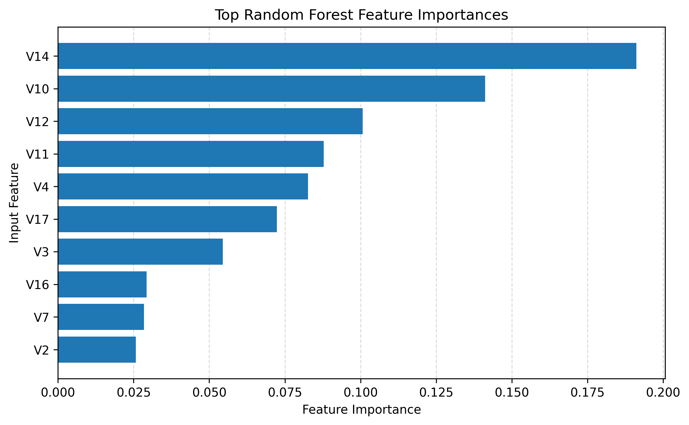
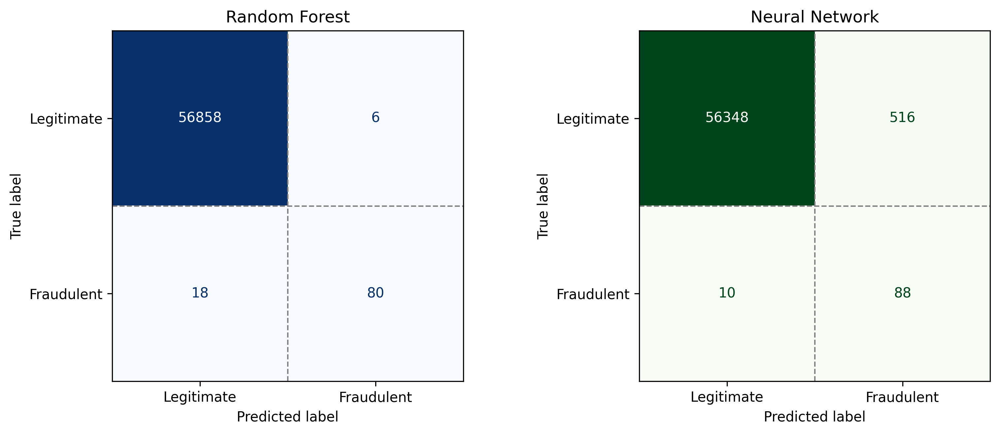

# Fraud Detection: Classical ML vs. Neural Networks

Detection of suspicious credit card transactions using classical machine learning and neural network approaches.
Capstone paper and code for the Data Analytics certificate at the **Air Force Institute of Technology (AFIT)**.

The project treats fraud detection as a **highly imbalanced binary classification** problem. It compares a trivial baseline, Logistic Regression, Random Forest and a multilayer perceptron (MLP) neural network on 284,807 real card transactions, of which only 0.17% are fraudulent.

> **Key result:** on the holdout test set, a class-weighted **Random Forest** achieved **PR-AUC 0.86** and **F1 0.87**. The best neural network achieved PR-AUC 0.73 and F1 0.25.

---

## Contents

```
├── paper_fraud_detection.pdf          # Full paper (IEEE-style)
├── fraud_detection_analysis.ipynb     # End-to-end analysis notebook
├── figures/                           # Figures used in the paper (generated by the notebook)
└── README.md
```

## Dataset

[Credit Card Fraud Detection](https://www.kaggle.com/datasets/mlg-ulb/creditcardfraud), Machine Learning Group, Université Libre de Bruxelles (Kaggle).

| Property | Value |
|---|---|
| Transactions | 284,807 (two days, September 2013, European cardholders) |
| Fraudulent | 492 (0.1727%) |
| Features | 30: `Time`, `Amount`, and `V1`–`V28` (anonymized PCA components) |
| Target | `Class` (0 = legitimate, 1 = fraudulent) |
| Missing values | None (1,081 exact duplicate rows, retained) |

The dataset is **not included** in this repository because of its size. Download `creditcard.csv` from Kaggle, rename it to `dataset_creditcard.csv`, and place it next to the notebook.

## Method

The workflow follows **CRISP-DM**:

1. **Data understanding.** Class distribution, transaction amounts by class, and fraud over elapsed time.
2. **Data preparation.** A stratified **60 / 20 / 20** train / validation / test split, so the rare fraud class is present in every subset. `RobustScaler` runs inside a pipeline to avoid data leakage.
3. **Class imbalance.** Handled with **class weighting** (`class_weight="balanced"` or sample weights). No oversampling or SMOTE is used.
4. **Models**
   - Trivial majority-class classifier (baseline)
   - Logistic Regression (class-weighted)
   - Random Forest (class-weighted)
   - MLP neural network: an architecture sweep over `(8,)`, `(16, 8)` and `(32, 16)`, then L2 regularization and early stopping
5. **Model selection** on the validation set, followed by a **single final evaluation** on the untouched holdout set.
6. **Overfitting check.** Training-loss comparison between a large unregularized MLP and the selected regularized MLP.

**Metrics:** PR-AUC, F1, precision and recall for the fraud class, and confusion matrices. ROC-AUC and accuracy are reported only as secondary metrics, because accuracy is misleading at a 0.17% positive rate. The trivial classifier scores 0.9983 accuracy while catching zero fraud.

## Results

### Validation set

| Model | ROC-AUC | PR-AUC | F1 | Precision | Recall |
|---|---|---|---|---|---|
| **Random Forest (class-weighted)** | 0.9706 | **0.7718** | **0.8065** | **0.8621** | 0.7576 |
| Logistic Regression (class-weighted) | 0.9747 | 0.6794 | 0.1116 | 0.0595 | 0.8990 |
| MLP (32, 16), α = 0.01 | 0.9555 | 0.6875 | 0.1867 | 0.1049 | 0.8485 |
| Trivial majority-class | 0.5000 | 0.0017 | 0.0000 | 0.0000 | 0.0000 |

### Holdout test set (final models)

| Model | ROC-AUC | PR-AUC | F1 | Precision | Recall | TP | FP | FN |
|---|---|---|---|---|---|---|---|---|
| **Random Forest** | **0.9803** | **0.8568** | **0.8696** | **0.9302** | 0.8163 | 80 | **6** | 18 |
| Neural Network (MLP) | 0.9617 | 0.7330 | 0.2507 | 0.1457 | **0.8980** | 88 | 516 | 10 |

The neural network catches 8 more frauds, but it raises **86× more false alarms**. The Random Forest gives the best balance between detecting fraud and keeping the review workload low.

| Feature importance (RF) | Holdout confusion matrices |
|---|---|
|  |  |

The most influential features are `V14`, `V10`, `V12`, `V11` and `V4`. Because they are anonymized PCA components, they show predictive contribution only and have no operational meaning.

## How to run

### Google Colab (recommended)

1. Open `fraud_detection_analysis.ipynb` in [Colab](https://colab.research.google.com/).
2. Upload `dataset_creditcard.csv` to the session (Files panel).
3. Run the first cell, which upgrades scikit-learn. Then choose **Runtime → Restart session** and **Run all**.

### Locally

```bash
pip install "scikit-learn>=1.7" pandas numpy matplotlib jupyter
jupyter notebook fraud_detection_analysis.ipynb
```

> **scikit-learn ≥ 1.7 is required:** earlier versions do not support `sample_weight` in `MLPClassifier.fit()`.
> Results were produced with scikit-learn 1.9.1 and `random_state=42`. Other versions may give slightly different Random Forest numbers.

The notebook saves all seven figures (`figure_1_…png` to `figure_7_…png`) at 300 dpi in the working directory.

## Limitations

- The features are anonymized, so the predictors cannot be interpreted in business terms.
- The data covers two days from a single source in 2013, so fraud patterns may have changed since then.
- All models use the default 0.5 decision threshold. Threshold tuning is left for future work.

## Author

**Revnic Oana Cristina**, Air Force Institute of Technology (AFIT), Data Analytics certificate capstone.

The views expressed are those of the author and do not reflect the official position of the U.S. Government, the Department of Defense or the U.S. Air Force.
